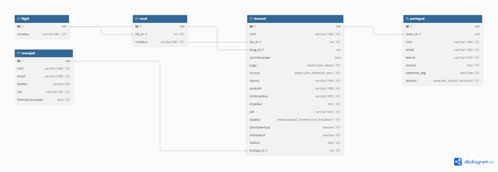

# Ülesanne 05 – ER-diagramm

Kliendi kirjelduse põhjal koostatud ER-diagramm loomade varjupaiga andmebaasi jaoks. Kasutatud tarkvara: dbdiagram.io.

## Tabelid

- **liigid** – loomade liigid (koer, kass, küülik)
- **toud** – tõud, iga tõug kuulub ühele liigile
- **tootajad** – varjupaiga töötajad
- **loomad** – varjupaigas olevad loomad
- **paringud** – külastajate saadetud päringud

## Seosed

- liigid 1 : N toud – ühel liigil on mitu tõugu, iga tõug kuulub ühele liigile
- liigid 1 : N loomad – iga loom kuulub ühte liiki
- toud 1 : N loomad – igal loomal on üks tõug
- tootajad 1 : N loomad – töötaja lisab mitu looma, iga looma on süsteemi lisanud üks töötaja
- loomad 1 : N paringud – ühe looma kohta võib olla mitu päringut (päring võib olla ka üldine, siis `loom_id` on tühi)

## Võtmed

- Primaarvõtmed (PK): `id` igas tabelis
- Võõrvõtmed (FK): `toud.liik_id`, `loomad.liik_id`, `loomad.toug_id`, `loomad.tootaja_id`, `paringud.loom_id`

## Normaliseerimine

Liigid ja tõud on eraldi tabelites, et nimetused ei kordu (2NF). Loomade tabelis kasutatakse nende asemel ID-sid ning töötaja andmed on tabelis `tootajad`, millele loom viitab võõrvõtmega (3NF).
